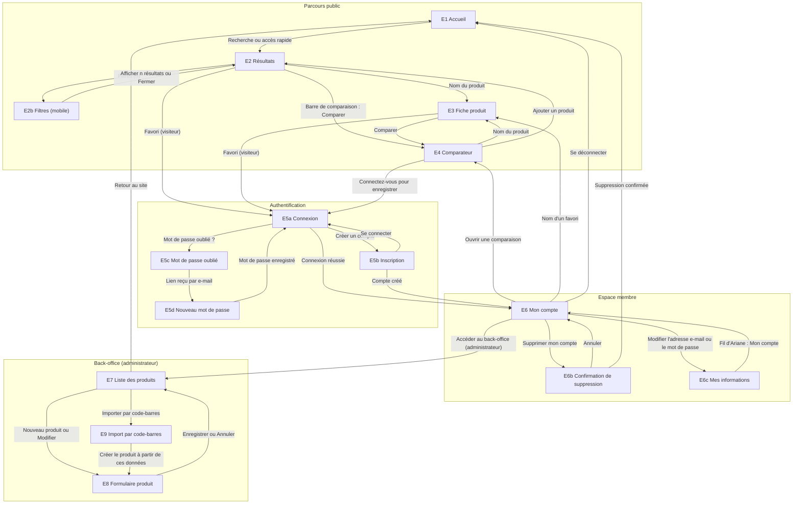

# Schéma d'enchaînement des écrans

> Issue #11. Enchaînement des écrans des wireframes et des maquettes (`docs/design/`).
> Chaque flèche porte l'action qui provoque le passage d'un écran à l'autre.

## Navigation commune aux écrans publics

L'en-tête, présent sur tous les écrans publics, donne accès à trois destinations :

- le logo mène à l'accueil (E1) ;
- « Comparer (n) » mène au comparateur (E4) ;
- le lien du compte mène à la connexion (E5a) pour un visiteur, ou à l'espace membre (E6) pour un membre.

Le pied de page mène aux pages légales et à la page des sources des données.

## Schéma

## Précisions

- **Connexion réussie** : le membre revient sur la page où il se trouvait avant de se connecter, par exemple la fiche produit s'il voulait l'ajouter à ses favoris. Le schéma montre l'espace membre (E6) comme destination par défaut, quand aucune page d'origine n'existe.
- **E2b** n'existe qu'en mobile : en desktop, les filtres sont une colonne permanente de E2.
- **E6b** est une fenêtre de confirmation affichée par-dessus E6, et non une page distincte.
- **Les autres listes du back-office** (marques et gammes, référentiels, enseignes, relevés de prix, imports) reprennent le gabarit de E7 : elles sont accessibles depuis la barre latérale, et ne figurent pas dans le schéma pour le garder lisible.
- **Les routes d'accès protégé** : un visiteur qui tente d'ouvrir E6 ou E6c est redirigé vers E5a ; un membre qui tente d'ouvrir le back-office reçoit un refus (US-15).
